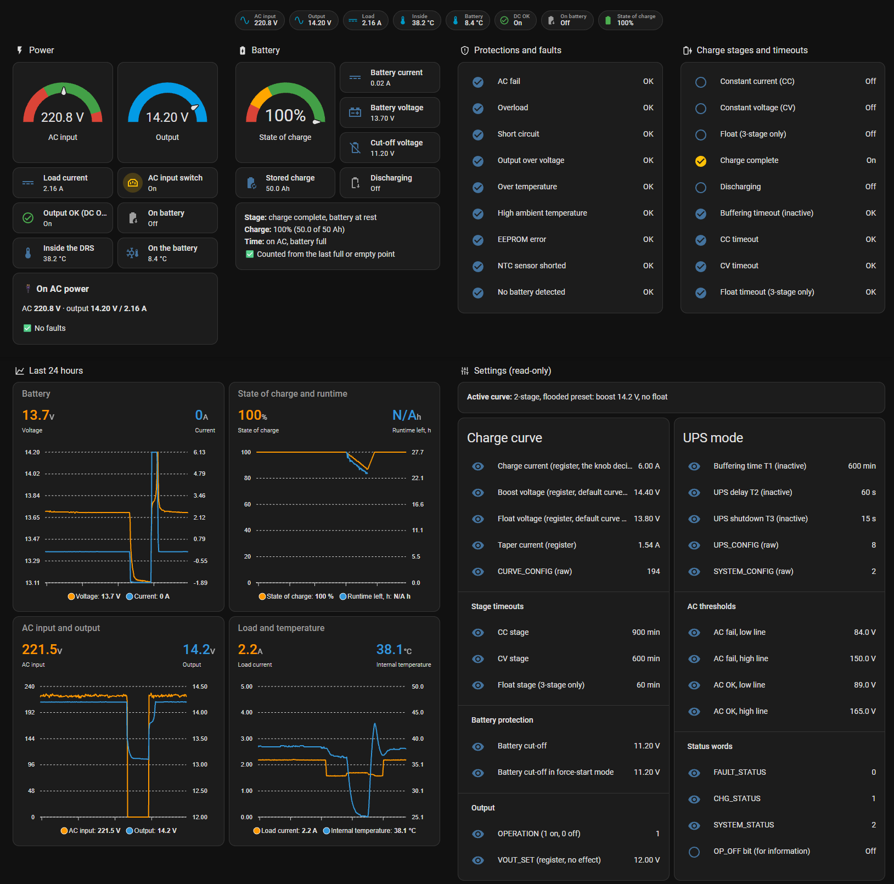
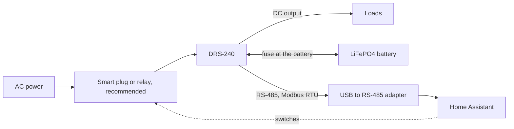

# Mean Well DRS-240 with Home Assistant

An unofficial field guide to the Mean Well DRS-240 DC-UPS: how to wire it, how it behaves in practice, how to charge a LiFePO4 battery with it, and how to monitor it in Home Assistant over Modbus. The repository includes a ready-to-use Home Assistant package and dashboard.

Everything here was measured on one DRS-240-12 with a 12.8 V 50 Ah LiFePO4 battery: about two weeks of bench tests, then two weeks on a site with frequent power outages. Where the guide repeats the manual, it says so. Where the unit behaved differently from the manual, it says that too.

> [!CAUTION]
> The DRS-240 connects to AC power, and a battery can deliver hundreds of amperes into a short circuit. Do all wiring on de-energized equipment, fit a fuse at the battery, and have a qualified person do the AC wiring. You use this guide, the package, and the register values at your own risk. See [Safety and disclaimer](#safety-and-disclaimer).

## How the parts connect

AC power feeds the DRS-240. The DRS powers the loads and charges the battery. Home Assistant reads the DRS over RS-485 (Modbus RTU) through a USB adapter.

## What you get

- **Sensors** for every useful register: AC input, output voltage and current, battery voltage and current, internal temperature, three status words decoded into 21 flags, and 21 settings read back every 5 minutes.
- **State of charge and runtime.** The DRS reports neither, so the package counts ampere-hours itself and corrects the count whenever the battery is full or empty.
- **Alerts** for a power outage, a low battery, a lost Modbus link, faults, changed settings, a battery that discharges while AC power is present, and a battery that isn't recharged.
- **A dashboard** with one view for everything.
- **A guarded write script** for the few registers worth changing. It refuses the three registers that control the output (`OPERATION`, `VOUT_SET`, and `SYSTEM_CONFIG`), and it limits the others to sane ranges.

## Key findings

These are the things the manual doesn't tell you, or tells you differently. The terms are explained in [Terms used in this guide](#terms-used-in-this-guide).

1. **The "12 V" output isn't 12 V.** On battery, and while charging, the output equals the battery voltage. After a 2-stage charge it stays at the boost voltage. In the final configuration of the tested unit, the loads saw 11.2 V to 14.2 V. See [Operating modes](docs/operating-modes.md#output-voltage).
2. **Several registers accept a write, read it back, and change nothing.** That includes the output voltage, the charge current, and the taper current. On the tested unit the charge current followed the knob on the panel and ignored the register. See [Modbus register map](docs/modbus-register-map.md#settings).
3. **3-stage charging drains a LiFePO4 battery.** In the float stage the AC side held 12.0 V, and the battery fed the whole load with AC present: about 9 Ah in 10 hours. See [LiFePO4 charging](docs/lifepo4-charging.md).
4. **2-stage charging with the flooded preset (14.2 V) worked.** After the charge the battery rests, isolated. On site there were 138 power outages in two weeks. For 69 of them AC stayed on long enough afterward to judge the result, and the charge restarted by itself after 67.
5. **Twice it didn't restart.** The DRS reported the constant-current stage while the battery kept discharging into the load, for about two hours the first time and two and a half the second, until the next interruption of AC power. That's why this guide treats the alerts and a remotely switchable plug on the AC input as part of the setup. See [LiFePO4 charging](docs/lifepo4-charging.md#when-the-charge-doesnt-restart).
6. **Leave the force-start pins open.** With CN12 pins 7 and 8 linked, the unit stopped switching to the battery after a battery cut-off. See [Hardware and wiring](docs/hardware-and-wiring.md#cn12-address-ntc-and-force-start).

## Quick start

Do the steps in this order. The last two settings of the unit need Home Assistant, so they come after the package.

1. With everything switched off, set the DIP switches for your battery and turn the charge current knob to its lowest setting: [The configuration that worked](docs/lifepo4-charging.md#the-configuration-that-worked), steps 1 to 4.
2. Wire the DRS, the battery with its fuse, the smart plug or relay on the AC input, and the RS-485 adapter, and power the unit up: [Hardware and wiring](docs/hardware-and-wiring.md).
3. Copy [`homeassistant/packages/drs240.yaml`](homeassistant/packages/drs240.yaml) into your Home Assistant, set the serial port, the slave ID, and the battery capacity, and restart: [Home Assistant setup](docs/home-assistant-setup.md), steps 1 to 6.
4. Now that you can see the battery current, set the charge current with the knob and write the battery cut-off: [Set the charge current](docs/lifepo4-charging.md#set-the-charge-current) and [Set the battery cut-off](docs/lifepo4-charging.md#set-the-battery-cut-off). Then finish with [step 7 of the setup](docs/home-assistant-setup.md#7-match-the-settings-reference).
5. Add the [dashboard](docs/dashboard.md).
6. Wait for the first charge to finish, then run the first two outage tests while you're still on site: [Repeat the tests on your system](docs/testing-and-results.md#repeat-the-tests-on-your-system). The tests take less than an hour. The charge before them can take several hours.

## Documentation

| Page | What it covers |
| --- | --- |
| [Hardware and wiring](docs/hardware-and-wiring.md) | Panel, terminals, battery fuse, RS-485 cable, Modbus address, optional parts |
| [Operating modes](docs/operating-modes.md) | On AC, on battery, cut-off, output voltage, start-up, charge curves, the Battery Start button |
| [LiFePO4 charging](docs/lifepo4-charging.md) | The float problem, what was tried, the configuration that worked, and its limits |
| [Modbus register map](docs/modbus-register-map.md) | Reference: registers, bit fields, and which writes take effect |
| [Home Assistant setup](docs/home-assistant-setup.md) | Installing and checking the package, entity reference |
| [State of charge and alerts](docs/state-of-charge-and-alerts.md) | How the counter works, how accurate it is, every alert, the write script |
| [Dashboard](docs/dashboard.md) | Installing the dashboard and reading it |
| [Testing and results](docs/testing-and-results.md) | Test method, numbers, and what wasn't tested |
| [Troubleshooting](docs/troubleshooting.md) | Symptoms, causes, and fixes |

## Terms used in this guide

| Term | Meaning |
| --- | --- |
| CC, CV | The two charge stages. Constant current: the charger pushes a fixed current. Constant voltage: it holds the boost voltage while the current falls |
| Boost voltage | The voltage the charger holds in the CV stage, 14.0 V to 14.6 V on the 12 V model, depending on the preset |
| Float | A third stage that's meant to hold a full battery at a lower voltage |
| Taper current | The current at which the charger ends the CV stage |
| 2-stage, 3-stage | Charging without or with the float stage. You choose with DIP switch 1 |
| Preset | A fixed pair of boost and float voltages, chosen with DIP switches 2 and 3. The "flooded" preset is named after flooded lead-acid batteries |
| Rest state | After a 2-stage charge: the charger is off, the battery is isolated, and the loads run from AC |
| Cut-off | The battery voltage at which the DRS disconnects the battery and switches the output off |
| BMS | Battery management system: the protection electronics inside a lithium battery |
| SOC | State of charge, in percent |
| DIP switches | The three small slide switches on the front panel |
| CN12 | A small pin header on the front panel. Two of its pins, 7 and 8, are the "force-start" pins |
| Slave ID | The address of the DRS on the Modbus link |
| EEPROM | The memory in which the DRS keeps its settings. It survives a limited number of writes |
| Inrush current | The short, high current that a power supply draws at the moment it's switched on |

## Tested hardware and limits

| Part | Tested with |
| --- | --- |
| DC-UPS | Mean Well DRS-240-12, Modbus version. The firmware version wasn't read |
| Battery | Offgridtec LiFePO4 12/50: 12.8 V, 50 Ah, built-in battery management system (BMS), no temperature sensor connected to the DRS |
| Battery line | 10 A fuse at the battery, 2.5 mm² stranded copper wire |
| RS-485 adapter | Waveshare USB TO RS485 (FTDI chip) |
| Remotely switchable relay on the AC input | Sonoff MINIR3 smart relay |
| 12 V regulator for sensitive loads | Mean Well DDR-60G-12 |
| Home Assistant | Home Assistant OS 18.3, Core 2026.9.4, on a Raspberry Pi 5 |
| Dashboard charts | apexcharts-card 2.2.3 |
| Period | First readings on October 3, 2026, bench tests October 12–28. Then moved to its site. This guide uses the first two weeks of site data |

Not tested: the 24 V, 36 V, and 48 V models, the DRS-480, the CANBus version, lead-acid batteries, the NTC temperature sensor, the AGM/LiFePO4 preset, charging below 8°C, and loads above 4.4 A. The published package is a generalized version of the one that ran in the tests. Its templates were rendered against the live test system, but the package as published hasn't run through an outage. The differences are listed in [Home Assistant setup](docs/home-assistant-setup.md#differences-from-the-tested-package).

## Safety and disclaimer

- **AC power can kill.** Disconnect power before you touch the terminals. If you aren't qualified to do AC wiring where you live, have an electrician do it. Connect the earth terminal.
- **Batteries don't switch off.** Fit a fuse in the positive wire, as close to the battery as you can, sized for the wire. Don't let tools bridge the terminals.
- **Register writes can switch your output off.** If your router runs from the DRS, a wrong write can cut you off from the site. In the tests, writing 0 to `OPERATION` did exactly that. The write script in this repository refuses that register and the two others that control the output. It still allows `UPS_CONFIG`, where three bits switch the output off under conditions you set. Read [the warning](docs/modbus-register-map.md#ups_config-address-210-0x00d2) before you write it.
- **No warranty.** This is a record of one person's tests on one unit, shared in good faith. It can be wrong for your unit, your firmware, or your battery. Check the manual of your battery and of your DRS before you copy a setting.
- **Not affiliated.** This project isn't affiliated with, endorsed by, or supported by MEAN WELL Enterprises Co., Ltd. or any other company or project named here, including Home Assistant. Product names are trademarks of their owners.

The official source for the DRS-240 is the [DRS-240/480 user manual on meanwell.com](https://www.meanwell.com/Upload/PDF/DRS-240,480-E.PDF). This guide cites it by section number and doesn't reproduce it. The section numbers refer to the 2026.03 edition (Ver 6). The relay status table in section 5.5 and the life test note aren't in the earlier 2023.10 edition.

## Contributing

Reports from other units are the most useful contribution: another model, another firmware, another battery, or the same setup behaving differently. Use the **Field report** issue form. See [CONTRIBUTING.md](CONTRIBUTING.md).

## License

Text and images are licensed under [CC BY 4.0](LICENSE). Code and YAML are licensed under the [MIT License](LICENSE-CODE).

To credit the text or images: "Mean Well DRS-240 with Home Assistant" by the meanwell-drs240-home-assistant contributors, <https://github.com/brusini/meanwell-drs240-home-assistant>, CC BY 4.0. Say so if you changed something.

Logos and trademarks that are visible in the photos belong to their owners and aren't covered by these licenses.
