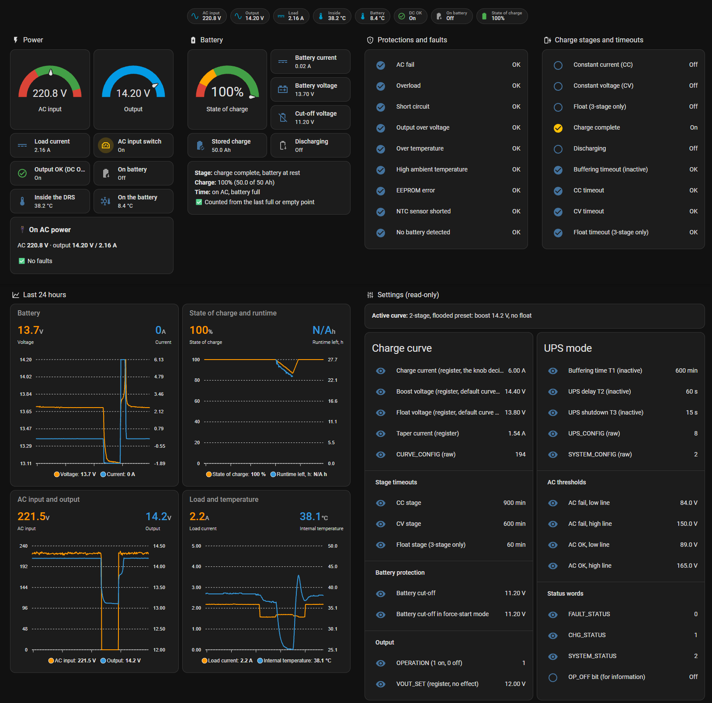
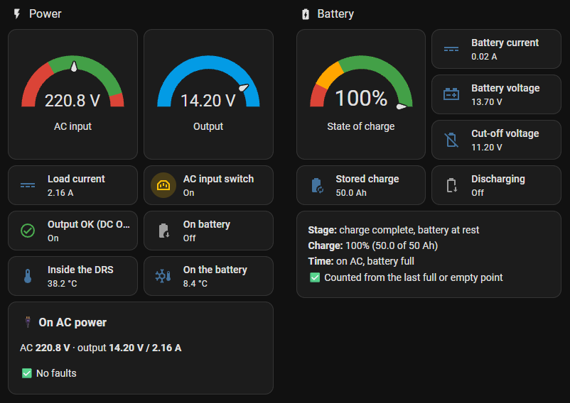
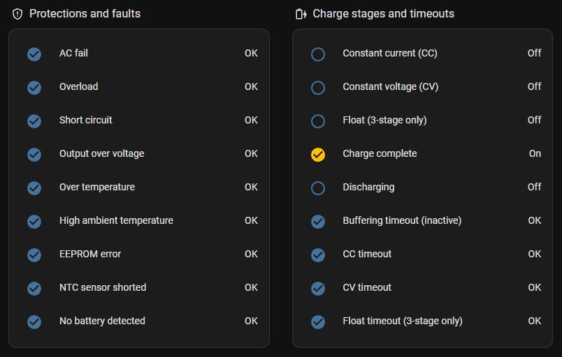
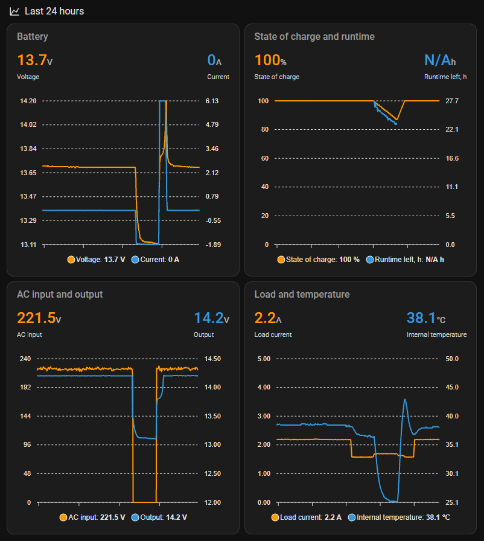
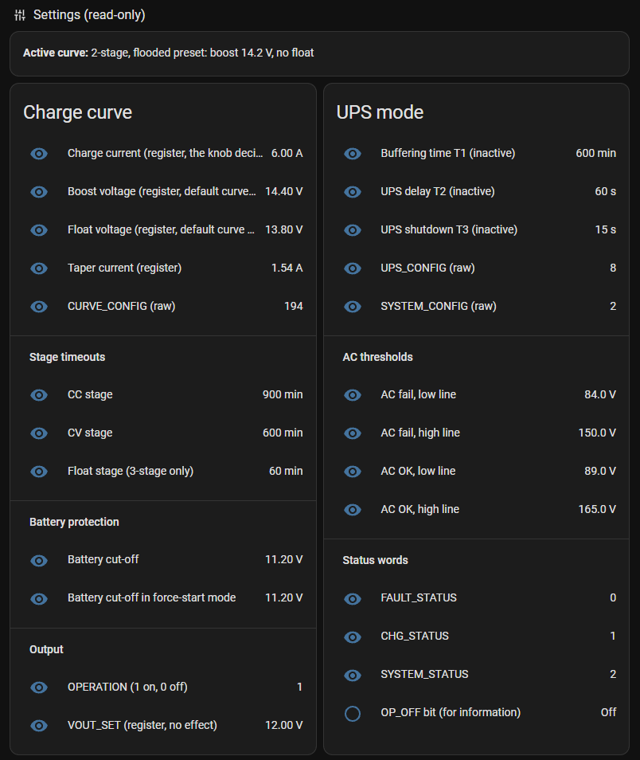

# Dashboard

This page shows how to add the DRS-240 dashboard to Home Assistant and how to read it. The dashboard is one view that shows the power path, the battery, the faults, the charge stages, four 24-hour charts, and the settings of the unit.



The screenshots on this page come from the tested system: a DRS-240-12 with a 50 Ah LiFePO4 battery, on AC power, in the rest state after a charge. They show the dark theme of Home Assistant, with the optional tiles turned on. The charts on your system also show the time of day on the horizontal axis. That axis was hidden for these screenshots.

## Before you start

- Install the package first: [Home Assistant setup](home-assistant-setup.md). The dashboard only displays entities that the package creates.
- Install the custom card **apexcharts-card** for the four charts. It comes from HACS, the community store for Home Assistant, which you install separately if you don't have it. In HACS, search for `apexcharts-card`, download it, and reload the browser. The dashboard was tested with version 2.2.3. Without the card, the charts show an error and everything else works.

## Add the dashboard

1. Open [`homeassistant/dashboards/drs240.yaml`](../homeassistant/dashboards/drs240.yaml) in a text editor. If you want the [optional tiles](#optional-tiles), turn them on now, in the file. You can't do it later in Home Assistant, because its editor removes all comment lines when you save.
2. Go to **Settings** > **Dashboards** and select **Add dashboard**.
3. Choose **New dashboard from scratch**, name it, and select **Create**.
4. Open the new dashboard, select the pencil icon to edit it, and take control if Home Assistant asks.
5. Open the three-dot menu and select **Raw configuration editor**.
6. Replace the content with the content of your file.
7. Select **Save**, then close the editor. If Home Assistant tells you that comments won't be saved, that's expected.

To add the view to a dashboard you already have, copy only the list item under `views:` into the `views:` list of that dashboard.

The view is a sections view laid out for a screen 1920 pixels wide, where it shows four columns. On a narrower screen the sections wrap.

## Optional tiles

The file contains three blocks whose lines start with `# optional:`. They're for devices that aren't part of the package:

| Block | What it shows | What you need |
| --- | --- | --- |
| Badge **Battery** | Temperature at the battery | A temperature sensor fixed to the battery |
| Tile **On the battery** | The same temperature, in the Power section | The same sensor |
| Tile **AC input switch** | The smart plug or relay in front of the DRS | A switch entity for it |

To turn a block on, edit the file before you paste it:

1. On each line of the block, delete `# optional:` and the one space that follows it. Don't touch the spaces in front of the `#`.
2. Replace `sensor.battery_temperature` or `switch.drs_ac_input` with your own entity ID.

Before and after, for the first two lines of the badge:

```yaml
      # optional: - type: entity
      # optional:   entity: sensor.battery_temperature
```

```yaml
      - type: entity
        entity: sensor.your_battery_temperature
```

The switch tile opens the details when you tap it. Only its icon toggles the switch, and only after you confirm. That's deliberate: switching the AC input off by accident starts a discharge.

## What the sections show

### Badges

The row at the top shows the AC input voltage, the output voltage, the load current, the internal temperature, DC OK, on battery, and the state of charge at all times.

Four badges appear only when they have something to say:

| Badge | Appears when |
| --- | --- |
| **DRS link**, red | The unit doesn't answer on Modbus |
| **Settings changed**, red | The settings of the unit differ from your reference |
| **Backup blocked**, red | See [Cut-off and backup blocked](state-of-charge-and-alerts.md#cut-off-and-backup-blocked) |
| **Time left** | The unit runs on battery |

### Power and battery



**Power** shows the AC input and the output as gauges, the load current, and the main state as a headline: on AC power, on battery, output off, or no link. Below the headline it lists the active faults, or "No faults".

**Battery** shows the state of charge, the battery current and voltage, the cut-off voltage, and the charge in ampere-hours. The text at the bottom has the three lines that matter most:

- **Stage** is the charge stage in words. If the unit reports a charge stage while the battery current is negative, it says "the DRS shows a charge stage, but the battery is discharging". That's the state described in [When the charge doesn't restart](lifepo4-charging.md#when-the-charge-doesnt-restart).
- **Charge** is the state of charge with the ampere-hours.
- **Time** is the runtime left on battery, the time to full while charging, or the state.

The last line tells you whether the state of charge is counted or estimated. See [How accurate it is](state-of-charge-and-alerts.md#how-accurate-it-is).

### Protections, charge stages, and timeouts



These two lists show the status bits of the unit one by one. In normal operation on AC, **Charge complete** is the only one that's on. Entries marked "3-stage only" or "inactive" can't turn on in the recommended configuration.

### Last 24 hours



| Chart | What to look for |
| --- | --- |
| **Battery** | Voltage and current. An outage shows as negative current. A charge shows as about 6 A positive, followed by a short peak in voltage |
| **State of charge and runtime** | The runtime line exists only while the unit runs on battery |
| **AC input and output** | The output steps down to the battery voltage during an outage and returns to the boost voltage after the charge |
| **Load and temperature** | The internal temperature rises during a charge |

Negative battery current while the AC input chart shows normal voltage is the sign of the "CC but discharging" state.

### Settings



This section is read-only. It shows the active charge curve as text, the registers behind it, the timeouts, the cut-off voltages, the AC thresholds, and the three raw status words. Labels such as "register, no effect" mark values that the tested unit stores but ignores. The background is in [Modbus register map](modbus-register-map.md#settings).

Next: [Testing and results](testing-and-results.md)
