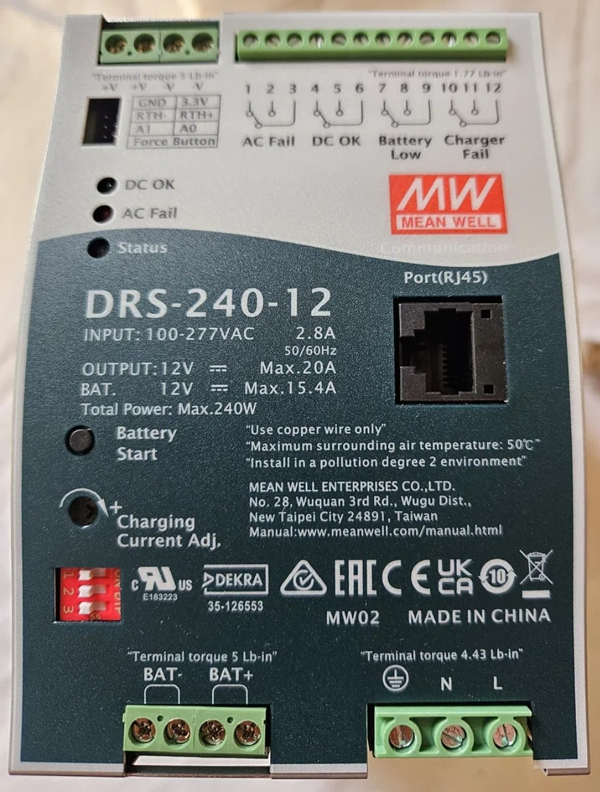
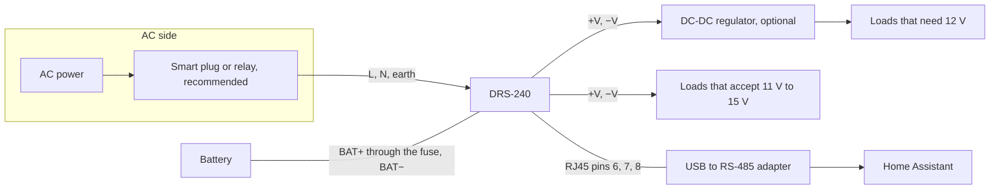
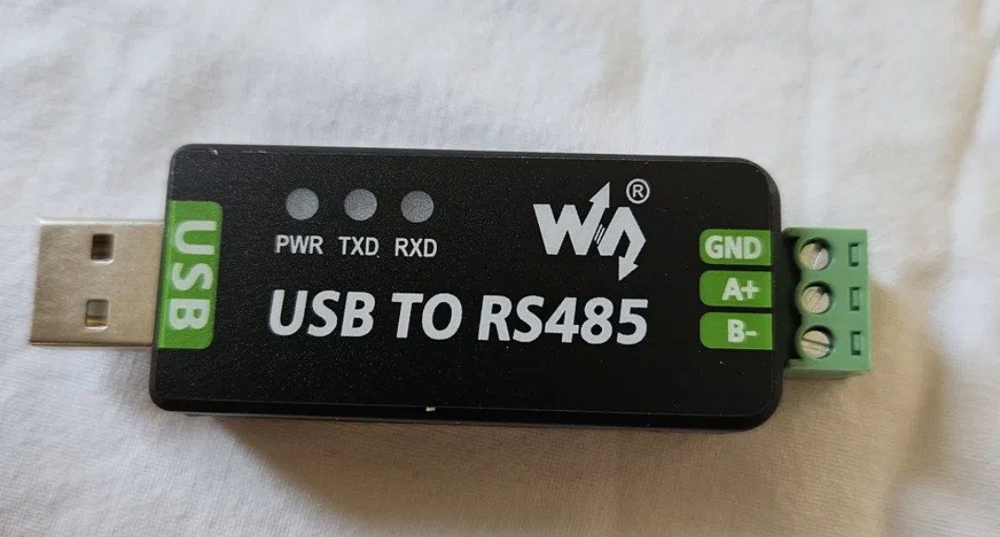

# Hardware and wiring

This page shows what's on the DRS-240 panel, how to wire the battery, the loads, and the RS-485 link to Home Assistant, and which optional parts are worth adding. It applies to the DRS-240-12. The other DRS-240 models have the same panel, but nothing here was tested on them.

This page isn't a replacement for the installation chapter of the manual. For DIN-rail mounting, clearances for cooling, and the wire size and breaker for the AC side, follow sections 3.1 to 3.3 of the manual and your local rules. If you want the shortest path to a running system, follow the [Quick start](../README.md#quick-start), which uses this page as its second step.

> [!CAUTION]
> The AC terminals carry line voltage. Disconnect AC power and remove the battery fuse before you touch any terminal. If you aren't qualified to do AC wiring where you live, have an electrician do it. A battery can deliver hundreds of amperes into a short circuit: the fuse holder is the first thing you connect to the battery, and the fuse is the last thing you insert.

## What you need

| Part | Notes |
| --- | --- |
| Mean Well DRS-240 | The Modbus version has no suffix after the voltage, for example DRS-240-12. The version with `CAN` at the end speaks CANBus instead, and this guide doesn't cover it (manual, section 2.1) |
| Battery | The manual recommends 20 Ah to 200 Ah for the 12 V model (section 3.4). Tested: 12.8 V, 50 Ah LiFePO4 with a built-in battery management system (BMS) |
| Fuse and fuse holder | In the positive battery wire, at the battery. Use a fuse rated for DC at your battery voltage. Tested: 10 A |
| Battery and load wire | Tested: 2.5 mm² stranded copper. The terminals take 12–24 AWG (section 4.1) |
| USB to RS-485 adapter | Any adapter that Home Assistant sees as a serial port. Tested: Waveshare USB TO RS485 |
| Ethernet patch cord | One RJ45 plug goes into the DRS. You cut the other end off |
| Smart plug or relay for the AC input | Strongly recommended with a LiFePO4 battery. It lets you interrupt AC power remotely. See [Recommended and optional parts](#recommended-and-optional-parts) |
| Optional | A temperature sensor for the battery, and a DC-DC regulator for loads that need a steady 12 V |

## The panel

The photo shows the tested unit as delivered, with the DIP switches in the factory position. From top to bottom on the front of the unit:

| Element | Label on the unit | What it's for |
| --- | --- | --- |
| DC output terminal, 4 positions | `+V +V -V -V` | Your loads. The two `+V` positions are the same rail, and so are the two `-V` positions |
| Alarm terminal, 12 positions | `AC Fail`, `DC OK`, `Battery Low`, `Charger Fail` | Four changeover relay contacts, three positions each, rated 30 VDC and 1 A (section 5.5). Not needed when you use Modbus |
| CN12 pin header, 2 × 4 pins | `GND 3.3V`, `RTH- RTH+`, `A1 A0`, `Force Button` | Modbus address, temperature sensor, force start. See [CN12](#cn12-address-ntc-and-force-start) |
| Three LEDs | `DC OK`, `AC Fail`, `Status` | See [Operating modes](operating-modes.md#leds-and-relay-contacts) |
| RJ45 socket | `Communication Port (RJ45)` | RS-485 for Modbus. It isn't Ethernet |
| Push button | `Battery Start` | Starts the unit from the battery. Read [the warning](operating-modes.md#the-battery-start-button) before you press it |
| Knob | `Charging Current Adj.` | Sets the charge current. On the tested unit it's the only thing that does |
| DIP switches, 3 | `ON`, `1 2 3` | Charge curve: 2 or 3 stages, and the preset |
| Battery terminal, 4 positions | `BAT-`, `BAT+` | Two positions for each pole |
| AC input terminal, 3 positions | earth symbol, `N`, `L` | AC power, 90 VAC to 305 VAC (section 2.3). The nameplate says 100–277 VAC |

The tightening torque is printed next to each terminal. On the tested unit: 5 lb-in (0.56 N·m) for the output and battery terminals, 4.43 lb-in (0.50 N·m) for the AC terminal, and 1.77 lb-in (0.20 N·m) for the alarm terminal.

## Wiring overview

AC power enters at the bottom right, the battery connects at the bottom left, the loads at the top left, and the RS-485 cable plugs into the RJ45 socket.

## AC input

1. Wire the smart plug or relay first, between your AC supply and the DRS. See [Recommended and optional parts](#recommended-and-optional-parts).
2. Connect the earth terminal of the DRS to protective earth. The manual requires it (section 1).
3. Connect `N` and `L`.

The unit typically draws 1.4 A at 230 VAC, with an inrush current of about 60 A at a cold start (section 2.3). A relay in front of the unit has to survive that inrush. The relay on the tested system is rated for 16 A and has switched the unit without trouble.

## Battery

1. Put the fuse holder in the positive wire, as close to the battery terminal as you can. Leave the fuse out for now.
2. Connect the battery negative to `BAT-` and the fused positive to `BAT+`.
3. Keep the wires as short as you can. The manual accepts 50 cm to 10 m (section 1).
4. Check the polarity with a meter before you insert the fuse.

How to size the fuse:

- It must protect the wire. That sets the upper limit.
- It must carry your highest load current, because during an outage the whole load runs through it. If your loads draw short peaks above the rated 20 A, the DRS takes them from the battery (section 5.9), and the fuse has to pass them too.
- It must carry the charge current. The DRS-240-12 can charge with up to 15.4 A. You set the actual value with the knob, and until you've done that, the knob has to be at its lowest setting. See [First power-up](#first-power-up).

On the tested system the load stayed below 4.4 A and the charge current was set to about 6.1 A, so a 10 A fuse on 2.5 mm² wire had enough margin.

> [!WARNING]
> Pulling the battery fuse during an outage switches your loads off. With AC present, the tested unit reported a missing battery when the fuse was pulled, and started a charge when it was put back. Keep the time without a battery short: Mean Well describes a [wake-up](operating-modes.md#start-up-and-wake-up) that repeats while no battery is connected, and it moves the output voltage.

## DC output and loads

Connect your loads to `+V` and `-V`. The DRS-240-12 delivers up to 20 A, and 240 W in total for the loads and the battery charge together, with priority for the loads (section 2.3).

Before you connect anything, read [Output voltage](operating-modes.md#output-voltage). The output isn't a regulated 12 V. In the final configuration of the tested unit it ranged from 11.2 V to 14.2 V. Earlier in the tests, a router connected directly to the output started to reboot in a loop when the output fell to 11.0 V. Loads that need a steady 12 V need a DC-DC regulator.

## RS-485 link to Home Assistant

The RJ45 socket on the DRS carries RS-485 on three pins (section 4.2):

| RJ45 pin | Signal | T568B wire color | Adapter terminal |
| --- | --- | --- | --- |
| 1 to 5 | Not connected | | |
| 6 | Data+ | Green | A+ |
| 7 | Data− | White-brown | B− |
| 8 | GND-AUX | Brown | GND |

1. Cut one plug off a patch cord and strip the three wires for pins 6, 7, and 8.
2. Check the pin-to-color mapping on your own cable. The colors above are for a T568B cable. A T568A cable uses different colors for pin 6. To find pin 1, hold the remaining plug with the latch facing away from you and the cable pointing down: pin 1 is on the left.
3. Connect them to the adapter: pin 6 to `A+`, pin 7 to `B-`, pin 8 to `GND`.

   

4. Plug the RJ45 end into the DRS and the adapter into the Home Assistant host.

The tested link is one patch cord between one adapter and one DRS, without a termination resistor or any other device on it. GND-AUX is isolated from the `+V` and `-V` output (section 4.2). The link runs at 115200 baud, 8 data bits, no parity, 1 stop bit (section 5.4.1.1). You set that in the package, not on the unit.

If the link doesn't work, see [Troubleshooting](troubleshooting.md#home-assistant-gets-no-answer-from-the-drs).

## CN12: address, NTC, and force start

CN12 is the small 2 × 4 pin header below the output terminal, at the top left of the panel (section 4.2).

| Pins | Function | What to do |
| --- | --- | --- |
| 1, 2 | 3.3 V and ground for a programmer | Leave open |
| 3, 4 | NTC temperature sensor (`RTH+`, `RTH-`) | Leave open for LiFePO4 |
| 5, 6 | Modbus address lines `A0` and `A1` | Leave open for address 131 |
| 7, 8 | Force start | Leave open |

The print next to the header names the four rows of pins, from top to bottom: `GND 3.3V`, `RTH- RTH+`, `A1 A0`, and `Force Button`. The `Force Button` row is pins 7 and 8.

**Modbus address.** The slave ID is 128 plus a device address from 0 to 3 (section 5.4.1.4). An open address line counts as 1, and a line linked to ground (pin 2) counts as 0. With both lines open, the device address is 3 and the slave ID is 131 (0x83). That's the only setting that was tested. The manual's pin table contradicts itself about which pin is `A0` and which is `A1`, so if you need another address, link one pin, then try the possible IDs from 128 to 131.

**NTC sensor.** The sensor supplied with the unit adjusts the charge voltage with temperature. The manual limits this function to lead-acid batteries (section 5.8.2). Without the sensor the unit works normally and reports a fixed battery temperature of 25.0°C. The sensor wasn't tested.

**Force start.** Linking pins 7 and 8 lets the unit start from the battery without AC power (section 5.7). Leave these pins open. With the link fitted, the tested unit stopped switching to the battery after a battery cut-off, until the battery was disconnected and reconnected. The details are in [LiFePO4 charging](lifepo4-charging.md#what-was-tried-and-why-it-failed).

## DIP switches and the charge current knob

Set the DIP switches with the unit switched off. Switch 1 selects 2-stage or 3-stage charging, and switches 2 and 3 select the charge curve (section 5.3.4.1). The switch body is marked `ON` on one side. A new unit has all three sliders on the other side, which is OFF. For a LiFePO4 battery, use the settings in [LiFePO4 charging](lifepo4-charging.md#the-configuration-that-worked).

The knob has no scale, only an arrow toward a plus sign for more current. You adjust it while a charge is running and read the result in Home Assistant. The procedure is in [Set the charge current](lifepo4-charging.md#set-the-charge-current).

## Recommended and optional parts

### A smart plug or relay on the AC input

This one is strongly recommended if you use a LiFePO4 battery. Put a remotely switchable plug or relay in front of the AC input. It lets you interrupt AC power for a few seconds from anywhere, and on the tested unit that restarts a charge that didn't start by itself. It happened twice in two weeks on site. See [When the charge doesn't restart](lifepo4-charging.md#when-the-charge-doesnt-restart).

Choose one that:

- Switches itself on again after a power outage. On most devices this setting is called the power-on state.
- Is rated for the inrush current of the DRS.
- Works in Home Assistant without an internet connection, if you can.

The tested system uses a Sonoff MINIR3 smart relay with its power-on state set to on.

> [!WARNING]
> If the network that reaches the plug runs from the DRS, an empty battery makes the plug unreachable. Switch it off only for a few seconds, and only while the battery has charge. The [dashboard](dashboard.md) tile for the plug asks for confirmation for this reason.

### A temperature sensor on the battery

Many LiFePO4 batteries refuse to charge below 0°C. The DRS can't see the battery temperature. Any temperature sensor that Home Assistant can read, fixed to the battery case, is enough for the optional [battery cold alert](state-of-charge-and-alerts.md#battery-cold-alert).

### A DC-DC regulator for 12 V loads

A regulator with a wide input range between the DRS output and the sensitive loads gives them a steady 12 V. The tested system uses a Mean Well DDR-60G-12 (9–36 V in, 12 V and 5 A out) for its network equipment. It measured 12.1 V at the output and added 1.5 W to 2 W of load. The router on it ran through a full discharge, down to the battery cut-off at 11.22 V, without a reboot.

## First power-up

1. Check that the DIP switches are set and that CN12 pins 7 and 8 are open.
2. Turn the charge current knob to its lowest setting: gently, against the arrow that points to the plus sign, until it stops. The charge starts as soon as the unit is powered, at whatever current the knob is set to, and that can be up to 15.4 A. At the lowest setting the manual gives 20%, about 3 A. The tested unit arrived charging at 2.61 A, so its knob was at or near that end, but don't count on it.
3. Insert the battery fuse.
4. Switch AC power on.
5. Watch the LEDs. `DC OK` turns green. `Status` is orange while the battery charges and green when the charge is complete.
6. Expect the output to dip a few seconds after the start. The unit lowers the output to 70% of the rated voltage, then raises it to the battery voltage (manual, wake-up note under `UPS_CONFIG` in section 5.4.1.6). The backup function isn't available during the first 5 seconds (section 5.3).

On the tested unit, in its final configuration, the charge started 22 seconds after AC power was switched on.

Next: [Operating modes](operating-modes.md)
