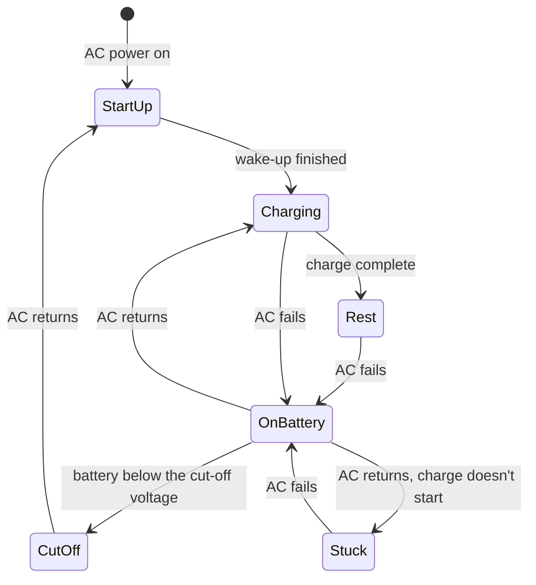

# Operating modes

This page explains what the DRS-240 does in each state: on AC power, on battery, and after the battery cut-off. It covers the output voltage, the start-up sequence, the charge curves, the Battery Start button, and the LEDs. Statements marked "manual" come from the Mean Well manual. Statements marked "tested unit" were measured on one DRS-240-12 with a 12.8 V LiFePO4 battery.

## States at a glance

The DRS is always in one of a few states. The diagram shows how the tested unit moved between them in 2-stage mode.

| State | Load runs from | Output voltage on the tested unit | `CHG_STATUS` |
| --- | --- | --- | --- |
| Charging, constant current (CC) or constant voltage (CV) | AC | Equal to the battery voltage, rising to the boost voltage | 2 (CC) or 4 (CV) |
| Rest, after a 2-stage charge | AC | The boost voltage: 14.2 V with the flooded preset | 1 |
| On battery | Battery | Equal to the battery voltage: about 13.6 V falling to the cut-off voltage | 128 |
| Cut-off | Nothing | Off | No Modbus answer |
| "CC but discharging" (stuck) | Battery, although AC is present | Equal to the battery voltage | 2 |

The last row is a fault state. It's described in [LiFePO4 charging](lifepo4-charging.md#when-the-charge-doesnt-restart).

## Output voltage

The DRS-240-12 is a 12 V unit, but the load output isn't a regulated 12 V.

| Situation | Output on the tested unit |
| --- | --- |
| Charging | Follows the battery voltage up to the boost voltage. 14.38–14.40 V on the default curve, 14.2 V with the flooded preset |
| Rest after a 2-stage charge | Stays at the boost voltage: 14.19–14.20 V with the flooded preset, 14.38 V on the default curve |
| On battery | Follows the battery voltage. With a LiFePO4 battery, about 13.6 V at first, 13.2 V to 12.8 V for most of the discharge, and 11.2 V at the cut-off |
| 3-stage mode, after the float stage timed out | 12.00 V |

Two things follow from this:

- **Check what your loads tolerate.** In the final configuration, the loads on the tested unit saw 11.2 V to 14.2 V. On the default curve the upper end is 14.4 V. Earlier in the tests, with a lower cut-off, a router connected directly to the output started rebooting in a loop at 11.0 V. Use a [DC-DC regulator](hardware-and-wiring.md#a-dc-dc-regulator-for-12-v-loads) for loads that need 12 V.
- **You can't set the output voltage over Modbus.** The `VOUT_SET` register accepts a value and reads it back, but the output doesn't change, even after a full power cycle. The manual marks Modbus control of the output as not supported (section 5.4.1.6, `SYSTEM_CONFIG` bit 0).

The switch to the battery takes less than 10 ms according to the manual (section 5.2.1). In the bench tests, a router on the output didn't reboot at the switch-over.

## Start-up and wake-up

Every time the unit powers up, it runs a wake-up sequence before it charges (manual, wake-up note under `UPS_CONFIG` in section 5.4.1.6). On a 12 V unit that means: 5 seconds at 12 V, a dip to 8.4 V (70%), then a rise to the battery voltage. Without a battery, the rise goes to 15.6 V (130%) before the output settles at 12 V.

The purpose is to wake a lithium battery whose BMS has switched off. You can't turn the wake-up at power-up off. The manual adds that the wake-up repeats every 5 minutes and that this repeat can be turned off with the `Wake_Up_EN` bit. A [Mean Well article on the DRS backup functions](https://www.meanwell.com/newsInfo.aspx?c=5&i=1555) says the repeat applies when no battery is connected. The tested unit, running without a battery, dropped its DC OK flag for about 5 seconds roughly every 10 minutes.

What this means for you:

- Loads see a dip, and possibly a peak, at every start of the DRS. Don't run the DRS without a battery in front of loads that can't take 15.6 V.
- The backup function isn't available in the first 5 seconds after power-up (section 5.3).

On the tested unit in its final configuration, the charge current reached 6.1 A 22 seconds after AC power was switched on.

## Charge curves

DIP switch 1 selects the number of stages (sections 5.3.1 and 5.3.2):

- **2-stage (DIP 1 ON).** Constant current, then constant voltage at the boost voltage. When the current falls to 10% of the rated current, the charge is complete: the Status LED turns green and the charger output switches off. The load output stays on.
- **3-stage (DIP 1 OFF, the factory setting).** The same, followed by a float stage that's meant to hold the battery at the float voltage.

DIP switches 2 and 3 select the voltages (section 5.3.4.1). For the 12 V model:

| DIP 2 | DIP 3 | Curve | Boost voltage | Float voltage (3-stage only) |
| --- | --- | --- | --- | --- |
| OFF | OFF | Default, programmable | 14.4 V | 13.8 V |
| ON | OFF | Gel preset | 14.0 V | 13.6 V |
| OFF | ON | Flooded preset | 14.2 V | 13.4 V |
| ON | ON | AGM and LiFePO4 preset | 14.6 V | 14.0 V |

The manual gives a tolerance of ±2% for these voltages.

What the tested unit did:

- **The constant-voltage stage is short.** At the end of a full charge of a 50 Ah LiFePO4 battery it lasted 6 to 12 minutes. It ended at about 1.5 A, which is 10% of the 15.4 A maximum charge current. Changing the taper current register (`CURVE_TC`) to 0.40 A didn't change that.
- **In the rest state the battery is isolated.** The battery current reads 0.01 A to 0.04 A, which is inside the ±0.2 A tolerance of that reading, so the true value is unknown. The battery voltage settles at 13.7 V to 13.9 V within a few hours and stays flat. The longest rest period on record is 15.9 hours.
- **The float stage doesn't regulate.** In 3-stage mode the battery fed the load for the whole float stage. This is the main problem with LiFePO4 batteries, and [LiFePO4 charging](lifepo4-charging.md) covers it.

When does the next charge start? The manual's relay status table in section 5.5 says that after a completed 2-stage charge, charging restarts when the battery voltage drops to 80% of the boost voltage. That's 11.36 V with the flooded preset, which is nearly empty for a LiFePO4 battery. In practice, the tested unit started a new charge almost every time AC power returned after an outage. "Almost" is the subject of [When the charge doesn't restart](lifepo4-charging.md#when-the-charge-doesnt-restart).

Each stage has a timeout, 600 minutes by default (section 5.4.4). The manual says that after a charge timeout the unit doesn't charge again until it's restarted. On the tested unit the CC timeout was raised to 900 minutes early in the tests, to leave room for a slow charge. That turned out to be a sensible margin: a full charge of the tested battery from the cut-off needs about 8.3 hours of charging at 6.1 A, which is about 500 of the default 600 minutes. The timeout was never reached in the tests.

## Charge current

The charge current knob (**Charging Current Adj.** on the panel, Io ADJ in the manual) sets the charge current between 20% and 100% of the maximum, which is 15.4 A on the DRS-240-12 (section 5.3.3). That makes about 3.1 A the lowest setting on paper. The tested unit charged at 2.61 A as delivered.

On the tested unit the knob is the only control. The unit arrived charging at 2.61 A. With the `CURVE_CC` register at 6.00 A since before the charge began, turning the knob took the current to 7.07 A. Writing the register down to 5.00 A during that charge changed nothing. To set the current, see [Set the charge current](lifepo4-charging.md#set-the-charge-current).

## Battery cut-off and recovery

When the battery voltage falls below the cut-off voltage, the DRS switches the output off and disconnects the battery (sections 6.1.4 and 5.6.3). The register `BAT_UVP_SET` sets the voltage. The manual gives a default of 10.44 V for the 12 V model, and the tested unit read 10.50 V when new.

On the tested unit, with the cut-off set to 11.20 V:

- All four cut-offs in the tests happened at 11.20 V to 11.23 V.
- Without the force-start link, the unit went completely silent: no output, no Modbus answer.
- When AC power returned, the output came back by itself, the charge started at about 6.1 A at once, and the Modbus link recovered without a restart of Home Assistant.
- An outage 10 minutes after AC power returned ran on the battery normally.

The output comes back by itself because of the `OPERATION_INIT` bits in `SYSTEM_CONFIG`: the tested unit reads 2, which means "output on at power-up".

How to choose the cut-off voltage is in [LiFePO4 charging](lifepo4-charging.md#set-the-battery-cut-off).

## The Battery Start button

According to the manual (sections 5.6, 5.7.2, and 5.10), the button does three different things:

| Press | Effect |
| --- | --- |
| Short press | Starts the unit from the battery when no AC power is present |
| Hold for 3 seconds | Disconnects the battery from the unit |
| 5 short presses within 15 seconds, with AC present | Restores the factory settings after the next power cycle. The Status LED flashes green three times |

> [!WARNING]
> Holding the button for 3 seconds during an outage switches your loads off. Five quick presses reset the charge curve, the output, and the AC threshold registers to the factory values (the list is in section 5.10). Consider covering or labeling the button.

The package includes a watchdog for the second case: [`binary_sensor.drs_settings_ok`](state-of-charge-and-alerts.md#settings-watchdog) turns off when the settings differ from your reference.

The button functions weren't tested, with one exception: with the force-start pins linked, a long press with AC present had no visible effect.

## Battery life test

The DRS tests the battery periodically. The manual (life test note under `UPS_CONFIG` in section 5.4.1.6) says the test runs every 30 seconds while the battery voltage is at or above the rated output and the charge current is at or above 5%, and that it's on by default.

On the tested unit, turning the life test off (`UPS_CONFIG` = 8) made no visible difference to charging or to the float problem. The unit has run with the life test off since then. The final configuration wasn't tested with the life test on.

## LEDs and relay contacts

What you see in normal operation:

| Situation | DC OK | AC Fail | Status | Seen on the tested unit |
| --- | --- | --- | --- | --- |
| On AC, charging | Green | Off | Orange | Yes |
| On AC, charge complete | Green | Off | Green | Yes |
| On battery | Green | Red | Orange, blinking | Not recorded |
| After the cut-off | Off | Off | Off | Yes: the unit is dark |

A red blinking Status LED is a fault. Count the blinks between the pauses (manual, section 4.3):

| Blinks | Fault |
| --- | --- |
| 1 | Charger |
| 2 | Battery over-voltage or reverse polarity |
| 3 | Battery low, or no battery |
| 4 | Peak load from the battery for too long |
| 5 | Overload or short circuit |
| 6 | Over temperature |
| 7 | Charge timeout |

No fault code appeared in the tests. For the charging state, the manual's LED table prints "Red" next to an orange symbol. Its charge-curve diagrams say orange, and that's what the tested unit showed.

The four relay contacts on the alarm terminal mirror AC fail, DC OK, battery low, and charger fail (section 5.5). The battery-low relay switches below 11 V ± 0.2 V on the 12 V model. With Modbus you get the same information, and more, from the status registers.

## Protections

From the manual (sections 2.3 and 6.1):

| Protection | Behavior |
| --- | --- |
| Overload, 105% to 135% of rated power | Limits the current, shuts the output down after 5 seconds. Power-cycle to recover |
| Short circuit | Limits the current, shuts down after 5 seconds. Power-cycle to recover |
| Output over-voltage, 16.2 V to 18.6 V | Shuts down. Power-cycle to recover |
| Over temperature | Shuts down and recovers when it cools. In charge mode it first reduces the output power |
| Battery reverse polarity | Protected by internal MOSFETs, recovers when the fault is removed |
| Battery under-voltage | The cut-off described above |

None of these protections was triggered in the tests, except the battery cut-off.

Next: [LiFePO4 charging](lifepo4-charging.md)
