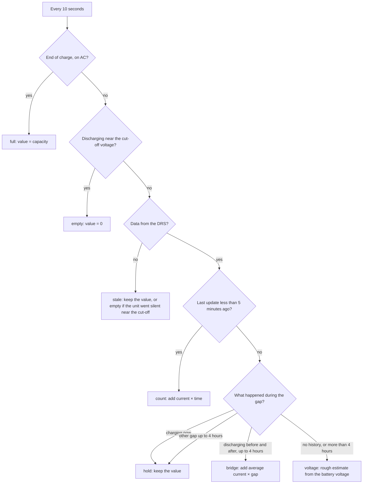

# State of charge and alerts

This page explains how the package estimates the state of charge of the battery, how far you can trust it, what each alert means, and how the register write script protects you. It also lists the values to change for a different battery.

## Why the package counts charge itself

The DRS-240 has no register for the state of charge (SOC). And with a LiFePO4 battery, the voltage is a poor gauge: by its maker's rest-voltage table, the tested battery moves only about 0.3 V between 90% and 30%.

So the package runs a coulomb counter: it adds up the battery current over time.

## How the counter works

Every 10 seconds, `sensor.drs_battery_charge` adds the battery current multiplied by the elapsed time to its value, in ampere-hours. The result is kept between 0 and the capacity. Readings below 0.1 A count as zero, because the current reading has a tolerance of ±0.2 A and the idle reading is noise.

A counter drifts, so it needs fixed points. The package has two:

- **Full.** At the end of a charge, when the unit reports "charge complete" (or float) with the battery at 13.9 V or more, on AC power. The counter is set to the capacity, and it stays there while the unit is on AC and the battery isn't discharging.
- **Empty.** While discharging, when the battery voltage falls to the cut-off voltage plus 0.15 V. The counter is set to 0. The same happens if the DRS stops answering during a discharge with the last battery voltage within 0.5 V of the cut-off.

The attribute `branch` shows which rule produced the current value:

| `branch` | When | Value |
| --- | --- | --- |
| `full` | End of a charge, then while on AC with no discharge | The capacity |
| `empty` | Discharging at or below the cut-off voltage plus 0.15 V, or the DRS went silent near the cut-off | 0 |
| `count` | Normal operation, and gaps of up to 5 minutes (a restart of Home Assistant) | Previous value plus current × time |
| `stale` | No data from the DRS | Previous value |
| `hold` | A longer gap while charging, or another gap of up to 4 hours | Previous value. While charging this is a lower bound |
| `bridge` | A gap of 5 minutes to 4 hours with discharge before and after | Previous value plus the average of both currents × gap |
| `voltage` | No history, or a gap of more than 4 hours, and not charging | A rough estimate from the battery voltage |
| `unknown` | No history while charging | Unknown until the next full point |

Two details that came out of the tests:

- **"Charge complete" alone doesn't mean full.** In 2-stage mode the flag can stay set through an outage, so the package also requires 13.9 V, or that the counter was already full.
- **The memory of the counter lives in two helpers.** `input_boolean.drs_soc_full_latched` and `input_boolean.drs_soc_calibrated` survive a restart of Home Assistant. Template attributes don't.

## How accurate it is

The attribute `calibrated` on `sensor.drs_battery_soc` tells you which kind of number you're looking at:

- `true`: the counter has passed a full or an empty point and has counted since. The dashboard shows "Counted from the last full or empty point".
- `false`: the value is an estimate from the battery voltage. Treat it as a guess until the first complete charge.

What limits the accuracy:

- **The current reading.** Its tolerance of ±0.2 A adds up to as much as ±1.6 Ah over 8 hours, which is ±3% of a 50 Ah battery. Every full point resets the error.
- **The capacity you entered.** The counter assumes the capacity in `input_number.drs_battery_capacity`. If your battery holds less, the percentage reads high near the end.
- **Gaps.** If Home Assistant is down for more than 5 minutes during a charge, the counter keeps its old value and reads low until the next full point.

Measured on the tested system, with a 50 Ah battery and the capacity set to 50:

- In two full discharges, of 30 hours and 15 hours, the counter still showed 1.3 Ah and 0.5 Ah when the battery reached the empty point. The cut-off followed 2 to 3 minutes later.
- After six site outages of 4 to 7 hours, with 7.5 Ah to 12.9 Ah drawn, the counter was back at the capacity by the time the unit ended the charge.
- Restarts of Home Assistant during a charge and in the rest state didn't change the value.

To measure your own capacity: charge fully, discharge to the cut-off with Home Assistant recording, and read how far the counter got. Do it with someone on site, because the output switches off at the end.

## Runtime estimate

`sensor.drs_battery_runtime` divides the remaining charge by the discharge current. It uses the larger of two currents: the average over about 5 minutes, and the present reading. The average alone starts near zero when AC power fails, and gave an estimate of hundreds of hours in the first minute of an outage.

The estimate assumes that the load stays as it is and that the battery delivers its full counted charge down to the cut-off.

## Alerts

All alerts call `script.drs_notify`. The thresholds are in the package and are easy to change. The first column shows the title of the message and, in parentheses, the `id` of the automation in the file.

| Alert | Fires when | Why | What to do |
| --- | --- | --- | --- |
| **No AC power** (`drs_ac_alert`) | `AC_FAIL` has been set for 5 minutes | Tells you an outage has started, with the SOC and the estimated runtime. Shorter interruptions stay quiet: on the tested site they came by the dozen | Nothing, unless the runtime is too short |
| **AC power is back** (`drs_ac_alert`) | AC has been back for 1 minute, after a reported outage | It then waits up to 15 minutes and tells you whether the charge started | If it says "no charge started", see the next two rows |
| **Battery discharging on AC** (`drs_discharge_on_ac`) | AC is present and the battery current has been below –0.3 A for 20 minutes | The ["CC but discharging"](lifepo4-charging.md#when-the-charge-doesnt-restart) state: the battery is draining although AC is present | Interrupt AC power to the DRS for 10 to 20 seconds |
| **Battery not recharging** (`drs_not_recharging`) | On AC for 1 hour with no charge stage and the SOC below 90% or the battery below 13.0 V. Or: a charge stage is shown, but less than 0.3 A has flowed for 30 minutes | The first case catches a battery that's left partly discharged. The second is meant for a BMS that refuses the charge, for example because the battery is too cold. That case didn't occur in the tests | Check the battery temperature and the fuse. Try interrupting AC power |
| **Low battery** (`drs_low_battery`) | On battery, and the SOC falls below 30%, then below 15%, the runtime falls below 1 hour, or the battery stays below 11.6 V for 2 minutes | Warns you before the cut-off. The voltage trigger works even if the counter is wrong | Reduce the load, or prepare for the output to switch off |
| **No Modbus link** (`drs_link_lost`) | The DRS hasn't answered for 2 minutes | If the last battery voltage was near the cut-off, the message says the cut-off is the likely cause. Otherwise it points to the power or the cable | After a cut-off: wait for AC. Otherwise check the adapter and the cable |
| **Modbus link is back** (`drs_link_back`) | The DRS answers again | After a cut-off, this is the message that tells you the unit is running again. In that case no "AC power is back" message follows | Nothing |
| **Fault** (`drs_fault`) | A fault flag is set for 30 seconds: overload, short circuit, over-voltage, over temperature, high ambient temperature, EEPROM error, no battery, NTC shorted, CC or CV timeout | The unit reports a problem | See [Troubleshooting](troubleshooting.md) |
| **Fault** | The CC stage runs longer than 12 hours, or the CV stage longer than 4 hours | A charge that doesn't finish. A full charge of the tested battery takes about 8.3 hours | Check the battery and the charge current |
| **Fault** | The internal temperature is above 70°C for 5 minutes | The highest value in the tests was 62.6°C | Improve the airflow or reduce the charge current |
| **Fault** | The output is above 14.7 V for 1 minute | Protects the loads and the battery. 14.2 V to 14.4 V is normal | Check the DIP switches |
| **Fault** | `OPERATION` reads 0 | Someone switched the output off by command | Power-cycle the unit. See [Troubleshooting](troubleshooting.md#the-output-is-off-and-operation-reads-0) |
| **Fault** | The settings watchdog has been off for 10 minutes | A setting changed, for example after a factory reset | Read the `mismatch` attribute |

The float timeout flag isn't treated as a fault. In 3-stage mode it's the normal end of the float stage.

Some thresholds are judgment calls that weren't tuned in the tests. The 13.0 V in "battery not recharging" is one. Adjust them if they produce false alerts on your system.

### Settings watchdog

`binary_sensor.drs_settings_ok` compares 13 settings of the unit with a reference list in the package. Its `mismatch` attribute names each setting that differs, with the value read and the reference.

It exists because the settings can change without you: five presses of the Battery Start button restore factory values, and a moved DIP switch changes the curve. On the tested system, with a reference that matches that unit, it has read on since the tests.

Keep the reference in step with the unit. When you change a register on purpose, change the reference in the package too. [Match the settings reference](home-assistant-setup.md#7-match-the-settings-reference) shows how.

### Cut-off and backup blocked

Two sensors cover a situation that was seen only with the force-start pins on CN12 linked:

- `binary_sensor.drs_cut_off` turns on when AC is missing, the output is off, and the unit still answers.
- `binary_sensor.drs_backup_blocked` turns on after such a cut-off and stays on. In that state the tested unit charged the battery normally but dropped the output at the next six outages instead of switching to the battery. It turns off when the unit powers down completely, when the battery is detected again, or when the load demonstrably runs from the battery.

Without the link, the unit goes silent at the cut-off, both sensors stay off, and the backup worked after AC returned. If you leave the pins open, as this guide recommends, you won't see these sensors turn on. To clear `drs_backup_blocked` by hand, fire the event `drs_backup_blocked_reset` in **Developer tools** > **Events**.

### Battery cold alert

The optional package [`drs240_battery_cold.yaml`](../homeassistant/packages/drs240_battery_cold.yaml) watches a temperature sensor on the battery:

| Level | Fires when | Meaning |
| --- | --- | --- |
| Cold | Below 5°C for 30 minutes | Getting close to the charge limit |
| Frozen | Below 1°C for 30 minutes | The BMS is about to refuse the charge |
| OK | Above 7°C for 1 hour, after one of the above | Charging is possible again |

The thresholds follow the BMS of the tested battery, which stops charging below 0°C and resumes above 5°C. Discharging continues at lower temperatures. Check the datasheet of your battery and adjust the numbers.

This alert hasn't fired on the tested system. The battery there has stayed between 8°C and 12°C.

## The register write script

`script.drs_write_register` writes one register with Modbus function 0x06. It takes two fields, `address` and `value` (the raw value), and writes only if the pair is on its whitelist:

| Address | Register | Allowed raw values | Meaning |
| --- | --- | --- | --- |
| 176 | `CURVE_CC` | 400–800 | 4.00–8.00 A. Has no effect on the tested unit |
| 177 | `CURVE_CV` | 1380–1460 | 13.80–14.60 V |
| 178 | `CURVE_FV` | 1340–1380 | 13.40–13.80 V |
| 179 | `CURVE_TC` | 40–200 | 0.40–2.00 A. Has no effect on the tested unit |
| 180 | `CURVE_CONFIG` | 128, 192, 1920 | 128: temperature compensation off. 192 does the same, because the extra bit in it is the 2-stage bit, which follows the DIP switch whatever you write. 1920: 128 plus the three timeout indication bits |
| 181–183 | Stage timeouts | 60–1440 | 1–24 hours |
| 208 | `BAT_UVP_SET` | 1050–1200 | 10.50–12.00 V |
| 209 | `Force_BAT_UVP_SET` | 1000–1200 | 10.00–12.00 V |
| 210 | `UPS_CONFIG` | 0–63 | All six bits. Read [the warning](modbus-register-map.md#ups_config-address-210-0x00d2) first |
| 224–227 | AC thresholds | The ranges from the manual | |
| 228, 232, 233 | Buffering, delay, shutdown times | The ranges from the manual | |

Everything else is refused with an error, before anything is sent. That includes `OPERATION` (0), `VOUT_SET` (32), and `SYSTEM_CONFIG` (196). On the tested system, a call with register 0 stopped before the Modbus write.

To use it, go to **Developer tools** > **Actions**, choose **DRS write register**, and enter the address and the raw value. The new value shows up in the matching `sensor.drs_set_…` entity within 5 minutes.

The ranges are for the 12 V model and for the tested battery. If you narrow or widen them, do it in the `lim` list in the script.

> [!WARNING]
> A whitelist isn't a safety guarantee. `UPS_CONFIG` bits 2, 4, and 5 turn on timers that switch the output off on battery. And every write goes to the EEPROM of the unit. Write once, by hand, and check the result.

## Adapt the package to another battery

The package was tuned for a 12.8 V, 50 Ah LiFePO4 battery charged to 14.2 V with a cut-off at 11.20 V. For a different battery, review these values in `drs240.yaml`:

| Value | Where | Why it's there |
| --- | --- | --- |
| Capacity, 50 Ah | `input_number.drs_battery_capacity`, `initial:` | Upper limit of the counter and base of the percentage |
| 13.9 V | `drs_battery_charge`, three times in the line that starts with `and (is_state('input_boolean.drs_soc_full_latched'` | Minimum battery voltage for the full point. Must be below your boost voltage and above the resting voltage of a partly charged battery |
| 10.8 V and +0.15 V | `drs_battery_charge`, three times in the line that contains `[cutoff + 0.15, 10.8]` | Floor and margin of the empty point, relative to the cut-off voltage read from the unit. Change all three the same way |
| 11.2 V | `float(11.2)`, wherever the cut-off is read | Fallback while the cut-off setting hasn't been read yet |
| +0.5 V | `cutoff + 0.5`, in `drs_battery_charge` (three times), in the message of `drs_link_lost`, and in the dashboard | How close to the cut-off the last reading must be for a silent unit to count as cut off |
| Rest-voltage table | `drs_battery_charge`, the list that starts with `[[10.79, 0]` | Fallback estimate for the `voltage` branch. It's the table of the tested battery |
| 30%, 15%, 1 hour, 11.6 V | Automation `drs_low_battery` | Low-battery warnings |
| 13.0 V and 90% | Automation `drs_not_recharging` | "Not recharging" detection |
| 14.7 V | Automation `drs_fault` | Output over-voltage warning. Set it above your boost voltage and below what the loads and the battery tolerate |
| 70°C | Automation `drs_fault` | Internal temperature warning |
| 12 hours and 4 hours | Automation `drs_fault`, triggers `cc_long` and `cv_long` | Longest plausible CC and CV stage. Raise the first one if a full charge of your battery takes longer |
| Whitelist ranges | Script `drs_write_register` | Limits for the 12 V model |
| Settings reference | `drs_settings_ok`, `ref`, twice | The configuration you expect the unit to hold |
| Curve voltages in the text | `drs_active_curve` | The preset voltages of the 12 V model, shown as text |
| Gauge and chart ranges | The dashboard file | The output gauge runs from 10 V to 15 V, the AC gauge from 180 V to 260 V |

**A bigger or smaller 12 V LiFePO4 battery.** Change the capacity, and set the charge current and the fuse for the new battery. Then work out how long a full charge takes: capacity divided by charge current. If that's more than about 8 hours, raise the CC timeout of the unit and the 12-hour limit of the fault alert ([LiFePO4 charging](lifepo4-charging.md#the-configuration-that-worked) shows the register write). The voltages can stay.

**A 24 V, 36 V, or 48 V model.** Every voltage on this list changes, and so do the preset voltages, which this guide gives for the 12 V model only (the manual has them in section 5.3.4.1). None of that was tested. Treat the package as a starting point, not as a working configuration.

Next: [Dashboard](dashboard.md)
